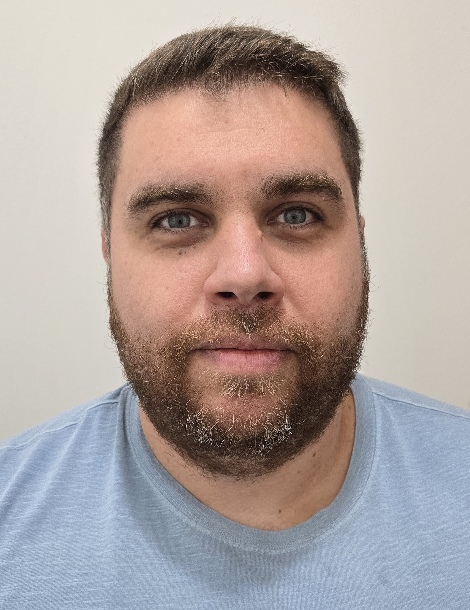
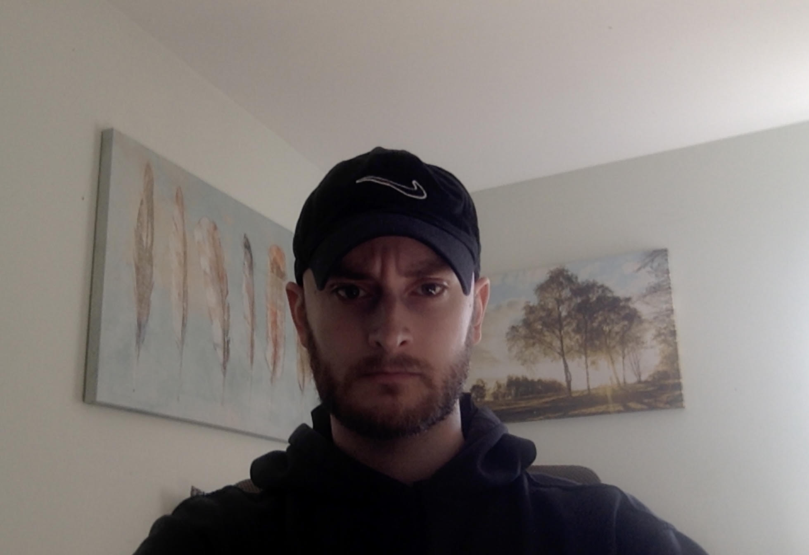
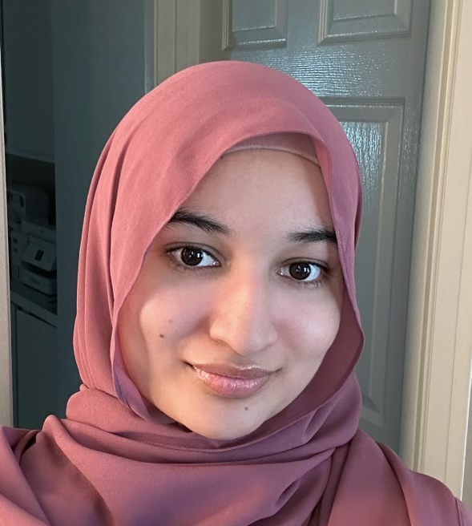
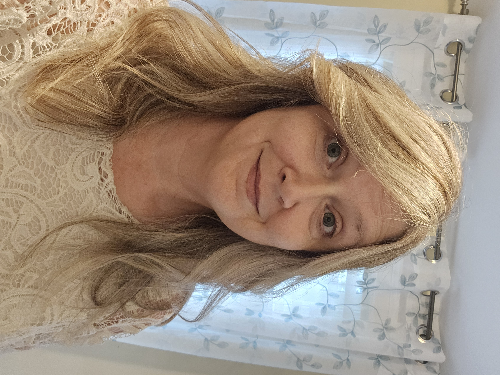
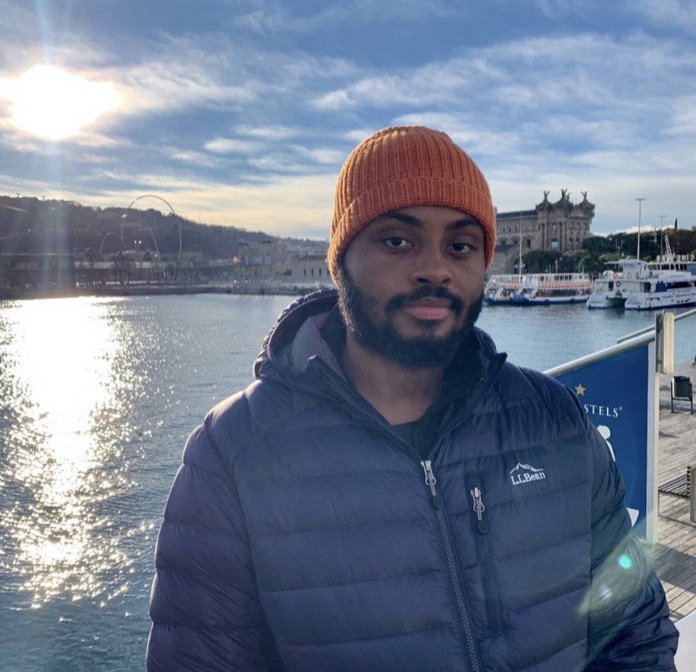
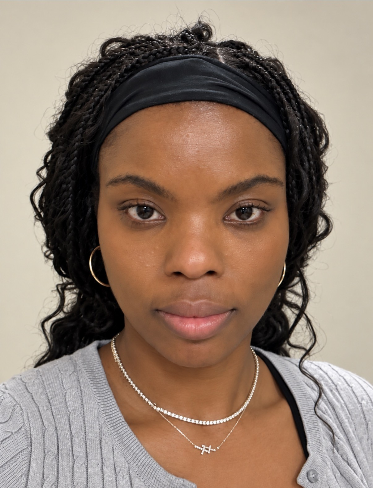
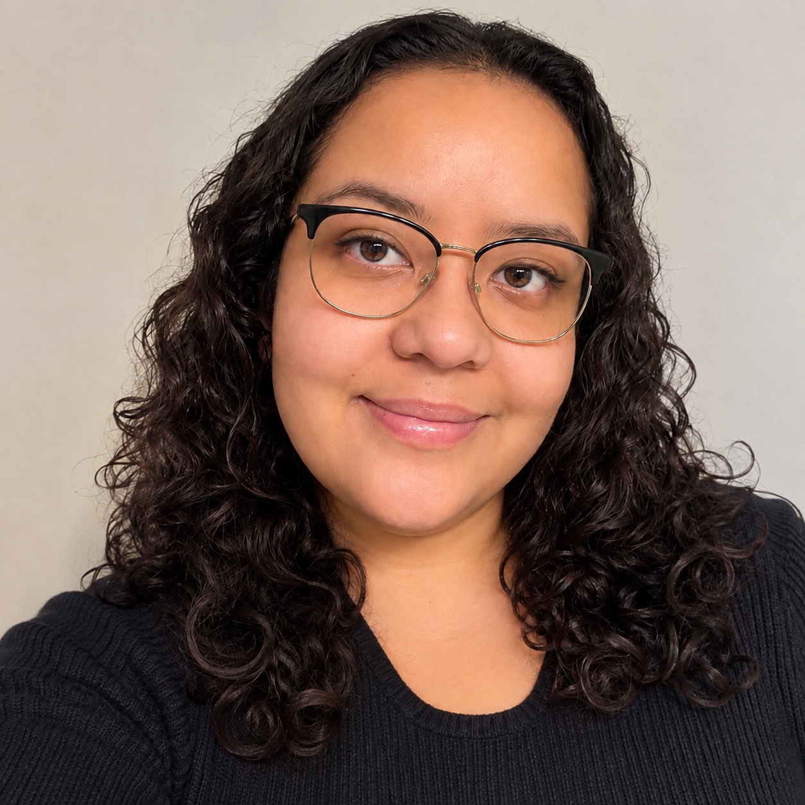

# Meet Team Green

[Home](./) | [Presentations](presentations.html) | [Meet the Team](team.html)

---

## About Our Team

Team Green is a group of Old Dominion University
students working together to develop VolunteerHub
as part of CS 410 and CS 411W.

Our team is collaborating on project research,
planning, documentation, and development.

---

## David Ortiz

David Ortiz is a Computer Science student at Old Dominion University and a US Navy veteran. After his service, he decided to change his career path and dive deep into software engineering by learning full-stack web development. He hopes to harness these skills, along with his faith in God and desire to further serve his community, to bring Team Green's VolunteerHub Project to life.

---

## William Harris

William Harris is a student at Old Dominion University
and a member of Team Green, working on the VolunteerHub
project for CS 410. He contributes to the team's
project development and documentation.

---

## Cindy Canupp

*Biography and professional headshot coming soon.*

---

## Sana Rasheed

 

Sana Rasheed is a Computer Science student at Old Dominion University. With prior experience as a tutor, she brings strong communication skills, patience, and a knack for breaking down complex concepts into clear, understandable steps. She is a dependable team member who contributes reliably to Team Green's VolunteerHub project.

---

## Danielle Rickard

Danielle Rickard is a Computer Science student at Old Dominion University. With an extensive background in Clinical Engineering, Danielle currently serves as a Senior Clinical Systems Analyst and Systems Administrator for a regional healthcare organization, where she manages critical clinical systems that support patient care. She brings strong analytical skills, technical expertise, and attention to detail to Team Green and the development of the VolunteerHub Project.

---

## Keiyon Tyler

Keiyon Tyler is a Computer Science student at Old Dominion University with a minor in Cybersecurity and a previous bachelor's degree in Business Administration from VCU. A U.S. Navy veteran and former Information Systems Technician, he currently works as a Systems Administrator III.  He hopes to contribute his IT experience and technical skills to Team Green's VolunteerHub Project.

---

## Juanita Thomas

Juanita is a Computer Science student at Old Dominion University with previous bachelor's degrees in Business and Psychology from ODU. With a professional background in taxation and finance, Juanita brings a combination of business experience, leadership skills and a multidisciplinary perspective to Team Green's VolunteerHub project.

---

## Jennifer Cano-Lopez

     
Jennifer Cano-Lopez is a Computer Science student at Old Dominion University with a background in pharmacy operations and inventory management.  She brings firsthand experience with healthcare information systems and databases to Team Green's VolunteerHub project. 

---

**Team Green | CS 410 | Fall 2026**
